# Kịch bản demo FPolyCinema

Thời lượng dự kiến: 15–18 phút, chia 6 phần theo vai trò (khách → bếp → quầy → soát vé → quản lý ca → quản lý rạp), cộng 3–5 phút hỏi đáp.
Mỗi bước có ba ý: **Thao tác** (bấm gì), **Lời nói** (gợi ý câu thuyết minh) và **Điểm nhấn** (quy tắc nghiệp vụ cần nói ra).
Ảnh minh họa chụp từ app thật ở khổ 1440 × 900, nằm trong thư mục [KichBan_Demo_anh](KichBan_Demo_anh).

---

## 0. Chuẩn bị trước buổi demo (làm trước 15 phút)

### 0.1. Tạo lại dữ liệu và chọn giờ ứng dụng

Dữ liệu mẫu sinh theo giờ lúc tạo DB, nên **mỗi lần demo nên tạo lại DB**. Nên để giờ ứng dụng khoảng **17:00** (giờ vàng): lúc đó có suất đang chiếu, suất sắp chiếu trong 15–60 phút và suất tối, đủ cho mọi bước bên dưới.

Đặt độ lệch `Demo:ClockOffsetMinutes` = (17:00 − giờ thật), tính bằng phút. Ví dụ demo lúc 22:00 thì lệch `-300`, demo lúc 09:00 thì lệch `480`.

```bash
dotnet run --project src/FPolyCinema.Web -- --reset-db --Demo:ClockOffsetMinutes=-300
```

Chạy xong mở http://localhost:5080. Trên **Trung tâm demo** (`/demo/multi-screen`) có dòng "Giờ ứng dụng: …" để kiểm tra giờ đã đúng chưa.

### 0.2. Cửa sổ trình duyệt nên mở sẵn

| Cửa sổ | Địa chỉ | Đăng nhập |
|---|---|---|
| A – Khách 1 | `http://khach-a.localhost:5080/` | Thanh đổi vai trò → Khách hàng (khach@) |
| B – Khách 2 | `http://khach-b.localhost:5080/` | Đăng nhập khach2@fpolycinema.vn / 123456 |
| C – Quầy | `http://cashier.localhost:5080/pos/index` | Thu ngân |
| D – Màn hình phụ | `http://localhost:5080/pos/customer-display?terminal=POS-01&cinemaId=1` | Không cần |
| E – Bảng gọi số | `http://localhost:5080/lobby/pickup-board?cinemaId=1` | Không cần |
| F – Quản lý | `http://manager.localhost:5080/` | Quản lý ca, sau đổi sang Quản lý rạp |
| G – Soát vé | `http://gate.localhost:5080/pos/gate-inspector` | Soát vé |

Mỗi tên miền phụ `*.localhost` giữ một phiên đăng nhập riêng, nên các vai trò không đá nhau. Chrome và Edge tự trỏ các tên này về máy.
Cách nhanh nhất là vào **Trung tâm demo** và bấm "Mở các màn hình" của từng kịch bản (lần đầu phải cho phép cửa sổ bật lên).

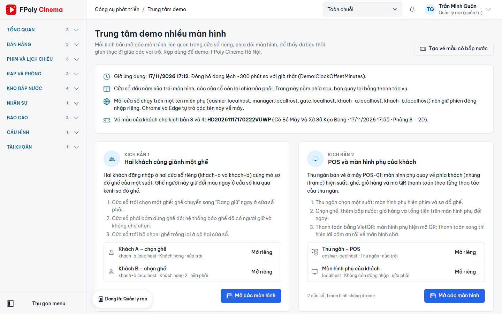

### 0.3. Thông tin cần nhớ

- Mật khẩu mọi tài khoản: `123456`. PIN quản lý (quản lý ca, quản lý rạp): `246810`.
- Thanh **"Đang là: …"** ở góc trái dưới dùng để đổi vai trò bằng một lần bấm.
- Mã voucher dùng khi demo: `FPOLY50K` (giảm 50.000 ₫ cho đơn từ 200.000 ₫).
- Checklist trước giờ G: app chạy không lỗi; cả 7 cửa sổ hiện "Đã kết nối" (chấm xanh); máy quầy đã có ca mở (thanh trên ghi "Ca mở lúc … · Tiền đầu ca …").

### 0.4. Lộ trình tổng quát

| Phần | Vai trò | Nội dung | Thời lượng |
|---|---|---|---|
| 1 | Khách hàng | Đặt vé online: suất → ghế AI → bắp nước, voucher → VietQR → vé điện tử | 4 phút |
| 2 | Khách + bếp | Hai khách giành ghế, trợ lý AI, "Tôi đã tới rạp" → bếp → bảng gọi số | 3 phút |
| 3 | Thu ngân | Bán tại quầy, luật ghế mồ côi, màn hình phụ, tiền mặt, in vé | 3 phút |
| 4 | Thu ngân + quản lý ca | Hủy hóa đơn đã thu tiền: PIN hoặc duyệt từ xa | 2 phút |
| 5 | Soát vé | Phòng đang dọn, kiểm tra tuổi, cho vào, chặn quét lại | 2 phút |
| 6 | Quản lý ca, quản lý rạp | Vận hành ca, hủy suất do sự cố, dashboard, AI xếp lịch, giá, báo cáo, đối soát | 4 phút |

---

## Mở đầu (khoảng 30 giây)

**Lời nói:** Em xin phép demo website FPolyCinema – hệ thống quản lý chuỗi rạp chiếu phim. Em sẽ đi theo đúng hành trình một tấm vé: khách đặt online, bếp làm bắp nước, thu ngân bán tại quầy, nhân viên soát vé cho vào phòng, và cuối cùng quản lý xem vận hành và báo cáo. Các màn hình cập nhật thời gian thực với nhau qua SignalR, nên thầy cô sẽ thấy thao tác ở cửa sổ này hiện ngay ở cửa sổ kia.

---

## Phần 1 – Khách đặt vé online (khoảng 4 phút, cửa sổ A)

### Bước 1.1 – Trang chủ

**Thao tác:** Mở cửa sổ A (đã là khách hàng Nguyễn Thu Hà, hạng VIP).

**Lời nói:** Đây là trang chủ của khách. Phía trên là phim nổi bật, bên dưới là ô mua vé nhanh (chọn rạp, phim, ngày, suất) và danh sách phim đang chiếu, sắp chiếu. Mỗi phim có nhãn độ tuổi theo Luật Điện ảnh 2022: P, K, T13, T16, T18.


### Bước 1.2 – Lịch chiếu

**Thao tác:** Bấm menu **Lịch chiếu**. Chỉ cho người xem các bộ lọc ngày, rạp, định dạng (2D, 3D, IMAX, 4DX), ngôn ngữ.

**Lời nói:** Lịch chiếu lọc theo 7 ngày tới, theo rạp, định dạng và phụ đề hay lồng tiếng. Mỗi giờ chiếu là một nút, kèm số ghế còn trống.

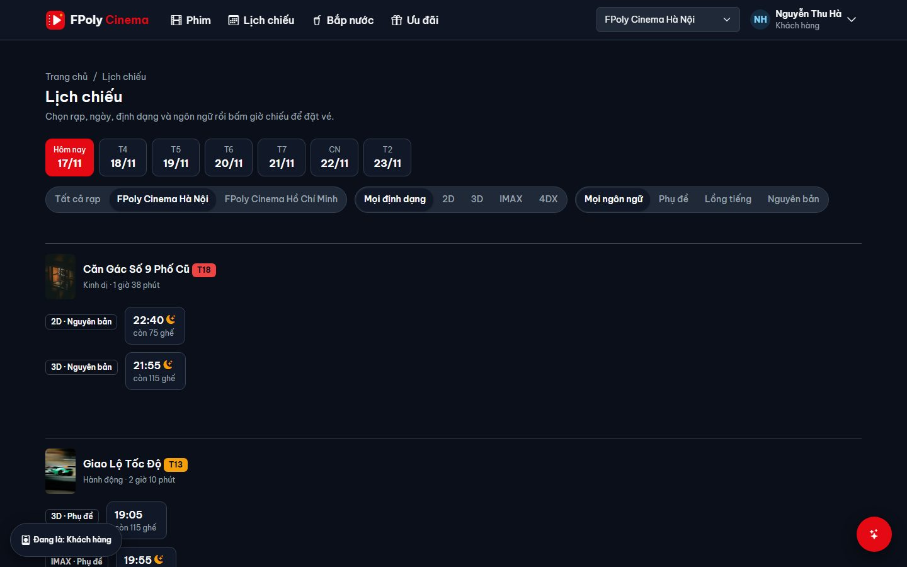

### Bước 1.3 – Sơ đồ ghế và gợi ý của AI

**Thao tác:** Bấm một suất sắp chiếu khoảng 1 tiếng nữa (trong ảnh: *Cô Bé Mây Và Xứ Sở Kẹo Bông*, 17:55, Phòng 3). Rê chuột lên vài ghế để hiện điểm.

**Lời nói:** Mỗi ghế có điểm góc nhìn và âm thanh từ 0 đến 100. AI đề xuất cụm ghế liền nhau đẹp nhất cho số vé khách cần, ở đây là F5–F6 được 91 điểm. Khách có thể đổi tiêu chí: đẹp nhất, gần màn hình, ghế đôi, gần lối đi. Viền vàng là ghế VIP, viền hồng là ghế đôi, biểu tượng xe lăn là chỗ cho người khuyết tật.

**Điểm nhấn:** Có lời nhắc giờ chiếu cho trẻ em: trẻ dưới 13 tuổi chỉ xem suất kết thúc trước 22:00, dưới 16 tuổi trước 23:00.

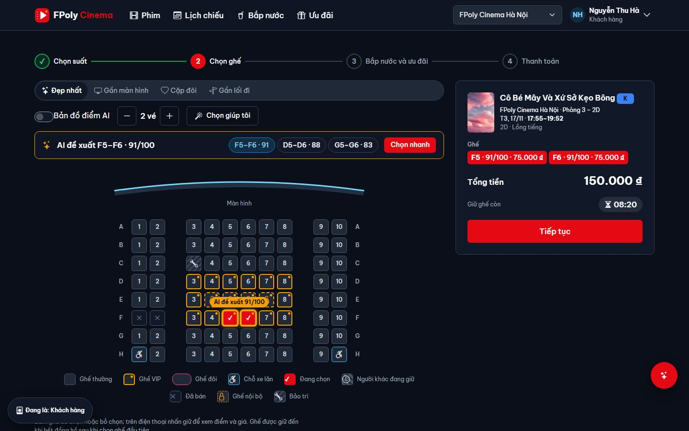

### Bước 1.4 – Chọn ghế, giữ ghế 10 phút

**Thao tác:** Bấm **Chọn nhanh**. Chỉ vào đồng hồ "Giữ ghế còn" ở khung bên phải.

**Lời nói:** Ngay khi chọn ghế, hệ thống tạo một hóa đơn trạng thái *waiting* và giữ ghế 10 phút. Hết giờ mà chưa thanh toán thì ghế tự trả lại. Đồng hồ chạy theo giờ máy chủ, nên máy khách có lệch giờ cũng không sai.


### Bước 1.5 – Bắp nước và voucher

**Thao tác:** Bấm **Tiếp tục**, thêm 1 *Combo Solo*. Kéo xuống, nhập voucher `FPOLY50K`, bấm **Áp dụng**. Chỉ vào công tắc "Dùng điểm".

**Lời nói:** Bước 3 là bắp nước và ưu đãi. Tổng tiền cập nhật ngay: 2 vé 150.000 ₫ cộng combo 79.000 ₫, trừ voucher 50.000 ₫ còn 179.000 ₫. Khách thành viên còn có thể đổi điểm, mỗi điểm bằng 1.000 ₫.

**Điểm nhấn:** Món nào hết nguyên liệu trong kho thì tự hiện "Tạm hết", vì mỗi món có định mức nguyên liệu (BOM).

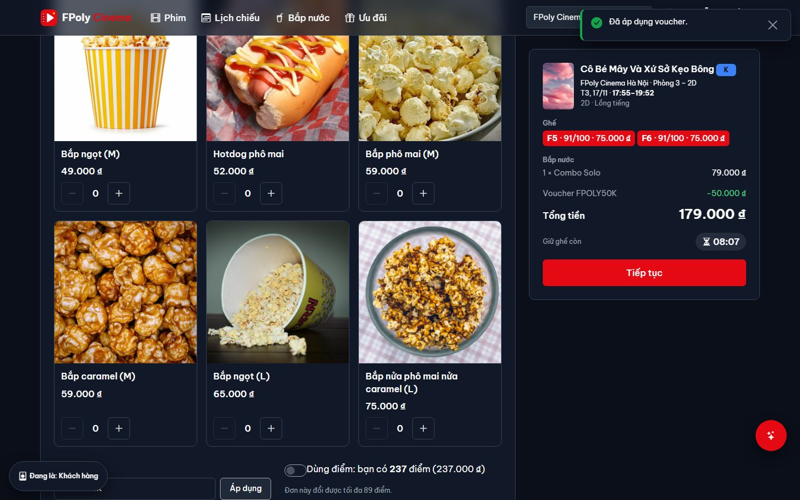

### Bước 1.6 – Thanh toán và xác nhận độ tuổi

**Thao tác:** Bấm **Tiếp tục**. Thử bấm **Thanh toán** khi chưa tích ô xác nhận để thấy thông báo lỗi, rồi tích ô và bấm lại.

**Lời nói:** Phim có nhãn tuổi thì khách phải xác nhận người xem đủ tuổi. Không tích thì không thanh toán được, và việc kiểm tra này nằm ở server chứ không chỉ ở giao diện. Khách chọn VietQR hoặc ví FPoly.

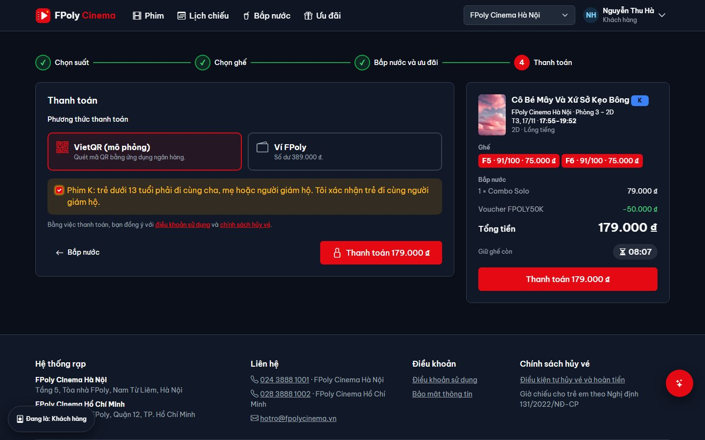

### Bước 1.7 – Mã QR và cổng thanh toán mô phỏng

**Thao tác:** Màn hình chờ hiện mã QR. Bấm **Mở trang thanh toán mô phỏng** (nên mở ở tab hoặc điện thoại khác cho giống thật), bấm **Thanh toán thành công**, rồi quay lại tab QR.

**Lời nói:** Đây là cổng VietQR mô phỏng. Khi thanh toán xong, cổng gọi lại *webhook* của hệ thống kèm chữ ký. Server kiểm chữ ký, chuyển hóa đơn sang *finish*, phát vé và báo về trình duyệt qua SignalR. Thầy cô thấy tab QR tự chuyển sang vé điện tử mà không cần tải lại.

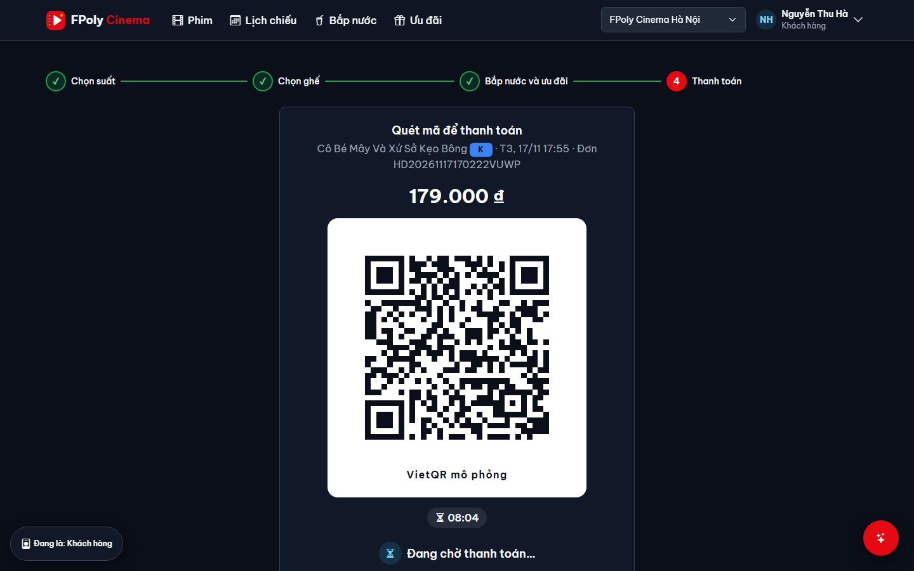

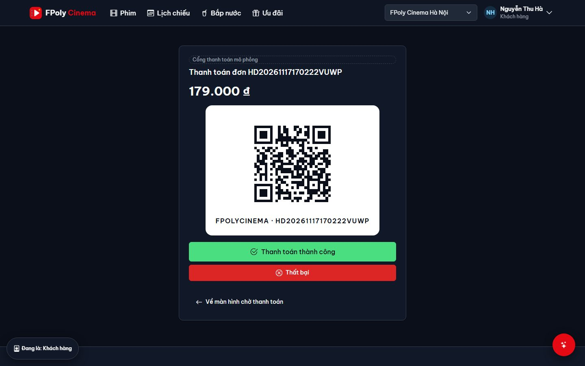

### Bước 1.8 – Vé điện tử

**Thao tác:** Chỉ vào QR từng vé, khối Bắp nước ("Chờ nhận") và khối Hủy vé.

**Lời nói:** Mỗi ghế là một vé có mã QR riêng. Khách được tự hủy trước giờ chiếu ít nhất 2 tiếng, tối đa 2 lần mỗi tháng. Tiền hoàn vào ví FPoly, voucher và điểm đã dùng được trả lại. Suất này còn dưới 2 tiếng nên nút Hủy vé đã bị khóa.

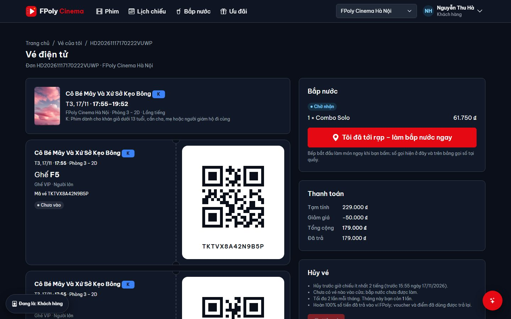

---

## Phần 2 – Thời gian thực: hai khách, trợ lý AI, bếp (khoảng 3 phút)

### Bước 2.1 – Hai khách cùng giành một ghế (cửa sổ A và B)

Nên làm bước này **trước bước 1.5**, khi ghế của khách A còn đang giữ. Hoặc dùng kịch bản 1 trên Trung tâm demo.

**Thao tác:** Đặt cửa sổ A và B cạnh nhau, cùng mở sơ đồ ghế của một suất. Ở A chọn một ghế; ở B ghế đó chuyển ngay sang biểu tượng đồng hồ "Người khác đang giữ". Ở B bấm vào ghế đó: không chọn được.

**Lời nói:** Hai kênh online và tại quầy dùng chung một cơ chế giữ ghế. Thao tác giữ ghế chạy trong transaction, khóa theo suất chiếu, nên nếu hai người bấm đúng cùng lúc thì người sau nhận lỗi `SEAT_TAKEN`. Một ghế không bao giờ bán hai lần.

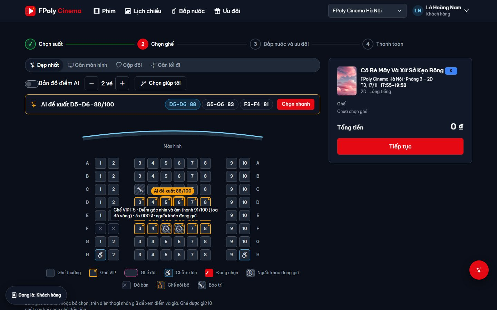

### Bước 2.2 – Trợ lý đặt vé AI (cửa sổ B)

**Thao tác:** Bấm nút tròn đỏ ở góc phải dưới, gõ "Tối nay 2 vé phim hành động, ghế đẹp nhất" rồi Enter.

**Lời nói:** Trợ lý hiểu câu tiếng Việt tự nhiên: thời gian, số người, thể loại. Nó tìm suất phù hợp, chọn cụm ghế đẹp nhất và hiện sơ đồ thu nhỏ. Khách bấm "Giữ ghế & thanh toán ngay" là vào thẳng bước thanh toán. Các nút gợi ý bên dưới giúp hỏi tiếp, ví dụ "Thêm 2 nước suối" hay "Đổi sang suất sau đó".

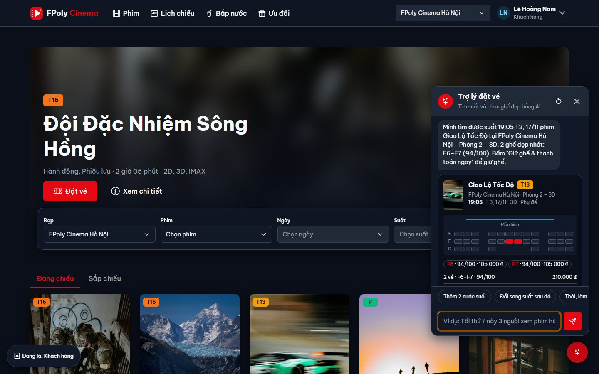

### Bước 2.3 – "Tôi đã tới rạp" → bếp → bảng gọi số (cửa sổ A, C, E)

**Thao tác:**
1. Cửa sổ C mở `/pos/fnb-kds` (màn hình bếp), cửa sổ E mở bảng gọi số.
2. Ở vé điện tử của khách A bấm **Tôi đã tới rạp – làm bắp nước ngay**. Vé hiện "Đang chuẩn bị · Số gọi 022".
3. Ở bếp, đơn 022 hiện ngay ở cột "Đang chuẩn bị". Bấm **Sẵn sàng giao**.
4. Bảng gọi số chuyển số 022 sang cột "Mời nhận đồ".

**Lời nói:** Khách không phải xếp hàng ở quầy bắp nước. Nút này chỉ mở trong 60 phút trước giờ chiếu, để bếp không làm món quá sớm. Bếp nhận đơn qua SignalR, màu thời gian chờ đổi sang vàng rồi đỏ khi chờ lâu. Số gọi hiện trên TV ở sảnh.

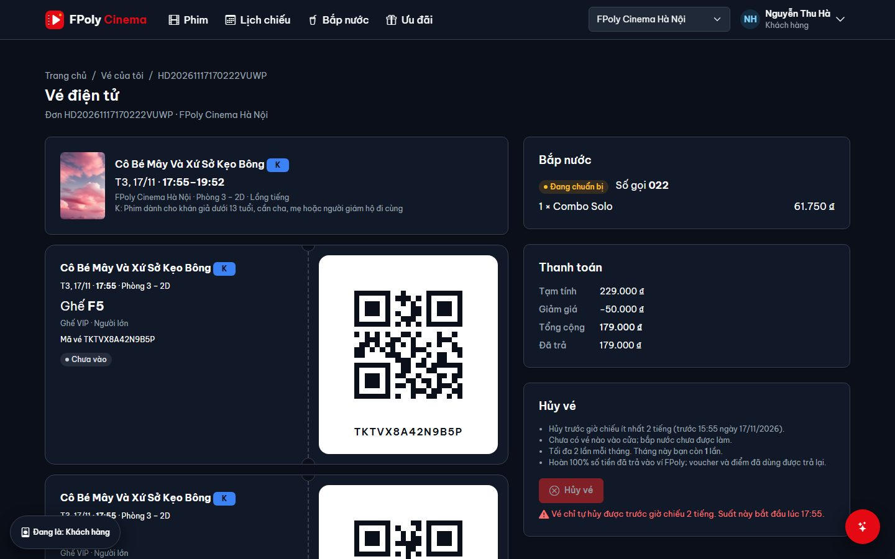

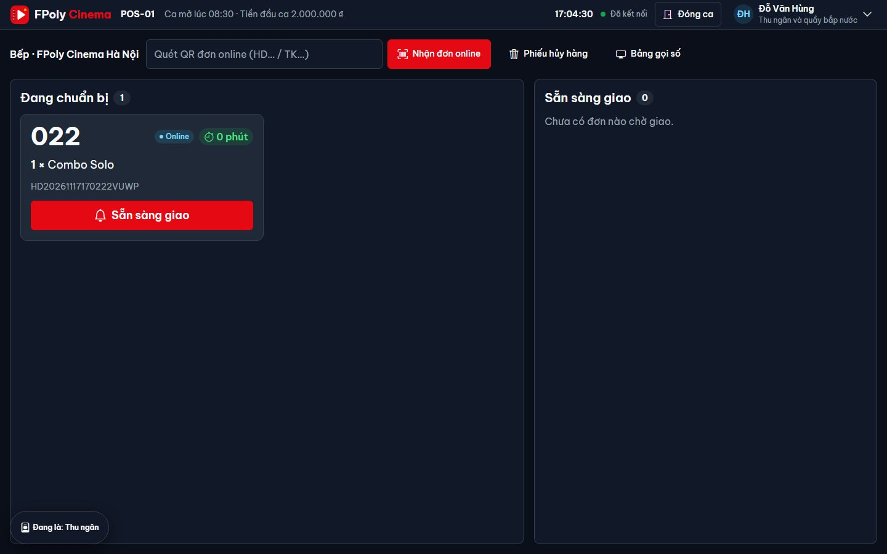

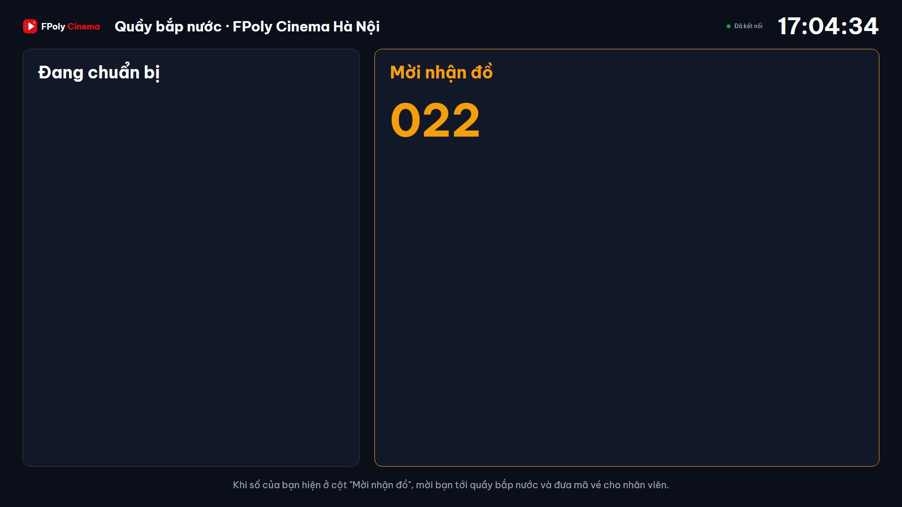

---

## Phần 3 – Bán vé tại quầy (khoảng 3 phút, cửa sổ C và D)

### Bước 3.1 – Màn hình POS

**Thao tác:** Mở `/pos/index`, chỉ vào thanh trên: máy POS-01, giờ mở ca, tiền đầu ca, chấm "Đã kết nối".

**Lời nói:** Thu ngân phải mở ca trước khi bán, nhập tiền đầu ca trong két. Màn hình chia ba cột: suất hôm nay, sơ đồ ghế và bắp nước, hóa đơn tạm tính. Có phím tắt cho thao tác nhanh: F1 tra thành viên, F4 thanh toán tiền mặt, Esc hủy hóa đơn tạm.

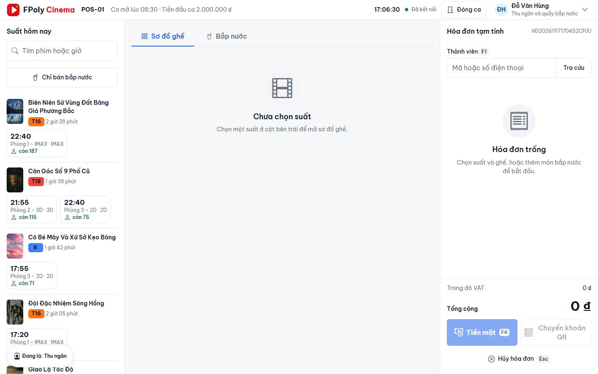

### Bước 3.2 – Luật ghế mồ côi

**Thao tác:** Chọn suất sắp chiếu (ảnh: 17:20, Phòng 1 – IMAX), bấm ghế **F2** để chừa lại một ghế lẻ F1 sát tường.

**Lời nói:** Hệ thống chặn cách chọn để lại một ghế lẻ, vì ghế lẻ rất khó bán. Nếu khách thật sự cần (ví dụ đi 3 người), thu ngân có thể "Bỏ qua luật" nhưng phải ghi lý do, và lý do được lưu vào nhật ký.

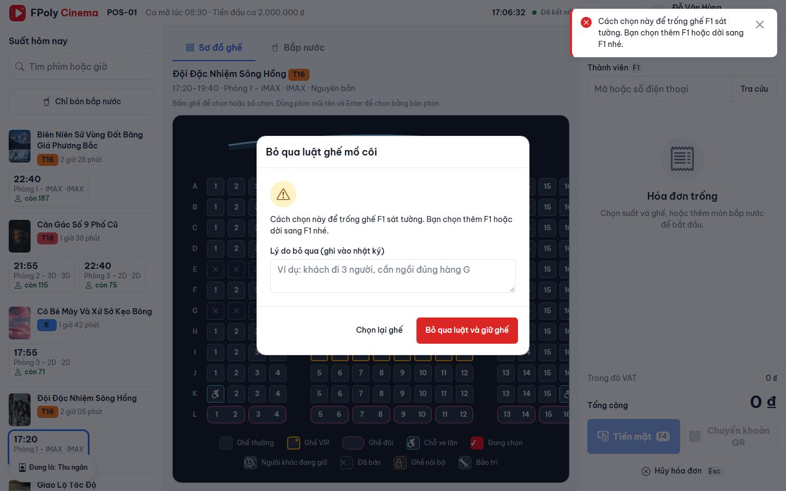

### Bước 3.3 – Chọn ghế, bắp nước và màn hình phụ của khách

**Thao tác:** Bấm **Chọn lại ghế**, chọn F7–F8 (hoặc F9–F10), sang tab **Bắp nước** thêm *Combo Couple*. Chỉ sang cửa sổ D.

**Lời nói:** Mỗi vé chọn được đối tượng (người lớn, U22, trẻ em…), giá tự trừ phần trăm ưu đãi. Màn hình phụ quay về phía khách cập nhật ngay theo từng thao tác: phim, ghế đã chọn, giỏ hàng, tổng tiền. Khi thu ngân chọn VietQR thì màn hình phụ hiện mã QR để khách quét.

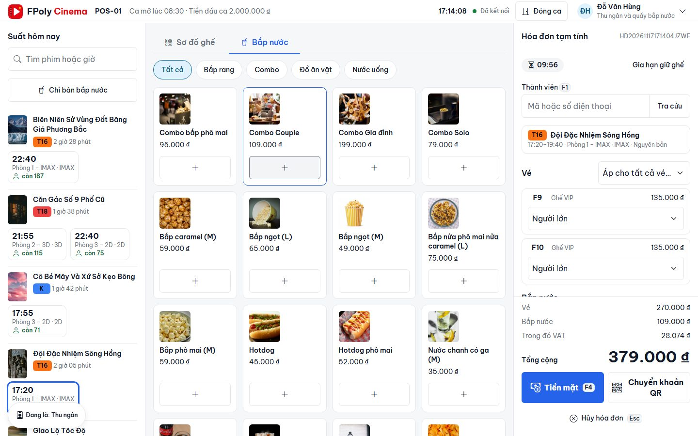

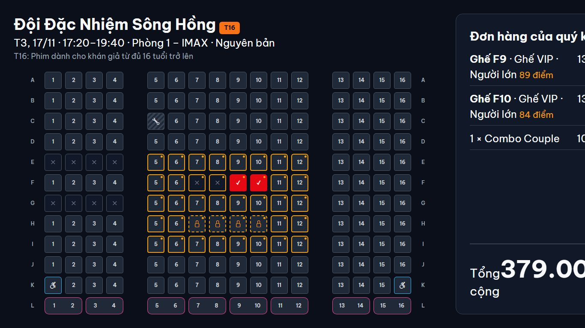

### Bước 3.4 – Thu tiền mặt và in vé

**Thao tác:** Bấm **Tiền mặt (F4)**. Thử nhập 100.000 → bấm xác nhận → báo "Tiền khách đưa chưa đủ". Sau đó bấm nút 500.000, chỉ vào dòng "Tiền thối 121.000 ₫", bấm **Xác nhận đã thu tiền**.

**Lời nói:** Tiền thối tự tính. Thanh toán xong hệ thống chuyển sang trang in: mỗi vé một phiếu có QR để soát, phiếu bắp nước có số gọi, cuối cùng là hóa đơn có VAT.

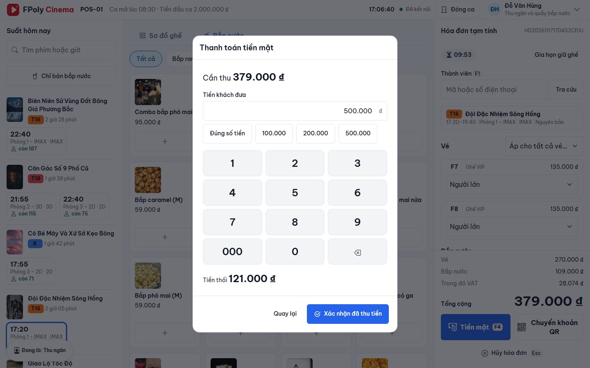

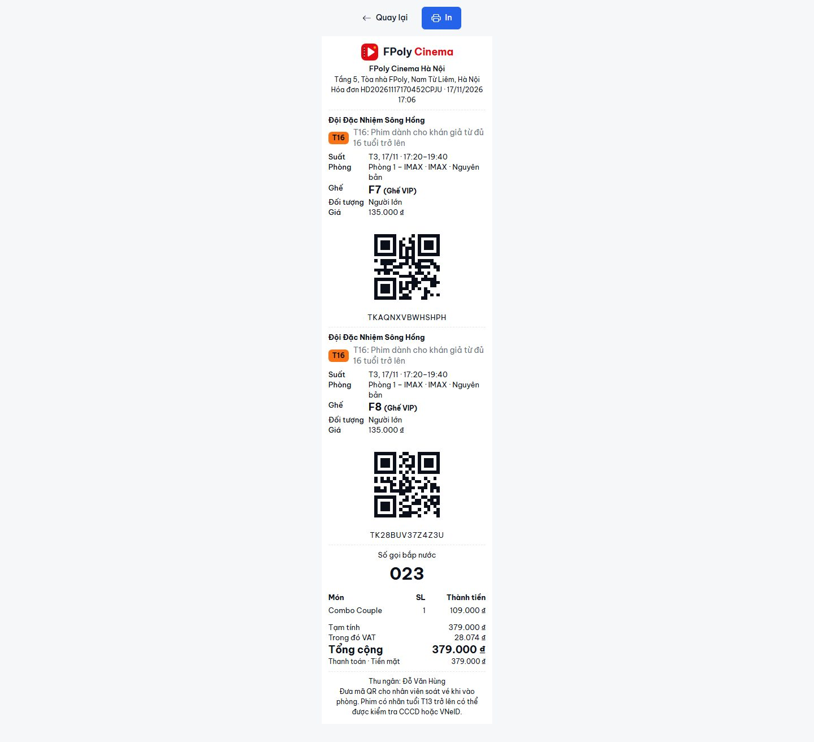

---

## Phần 4 – Hủy hóa đơn đã thu tiền (khoảng 2 phút, cửa sổ C và F)

### Bước 4.1 – Yêu cầu hủy

**Thao tác:** Ở POS bấm **Hủy hóa đơn đã thanh toán**, nhập mã hóa đơn vừa bán và lý do.

**Lời nói:** Để chống gian lận, thu ngân **không tự hủy được** hóa đơn đã thu tiền. Có hai cách duyệt: quản lý đứng cạnh nhập PIN, hoặc gửi yêu cầu cho quản lý duyệt từ xa. Chỉ hủy được khi chưa có vé nào vào cửa. Hủy xong thì tiền hoàn theo phương thức gốc (tiền mặt trừ vào két của ca), ghế trả về trống và điểm đã cộng bị thu hồi.

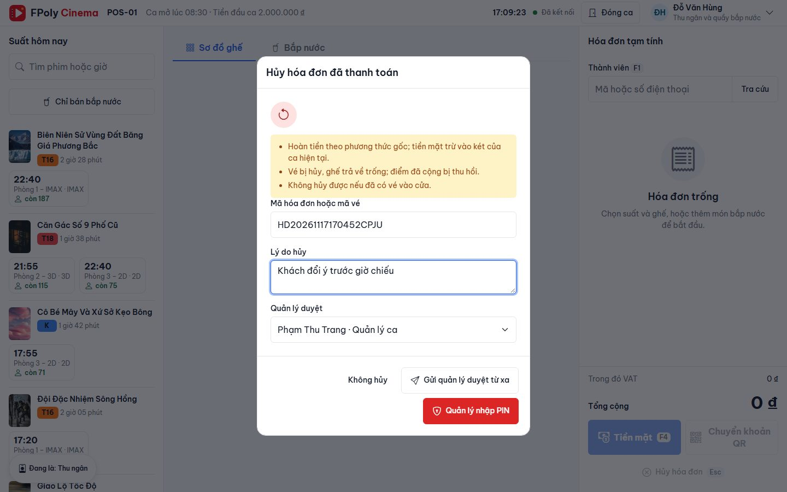

### Bước 4.2 – Cách 1: quản lý nhập PIN

**Thao tác:** Chọn quản lý, bấm **Quản lý nhập PIN**. Thử PIN sai (ví dụ 111111) → "Mã PIN chưa đúng. Còn 4 lần thử". Nhập `246810` → "Đã hủy hóa đơn … và hoàn tiền. Người duyệt: …".

**Lời nói:** PIN lưu dạng băm. Sai 5 lần thì bị khóa tạm. Mọi lần duyệt đều ghi lại ai yêu cầu, ai duyệt và lý do.

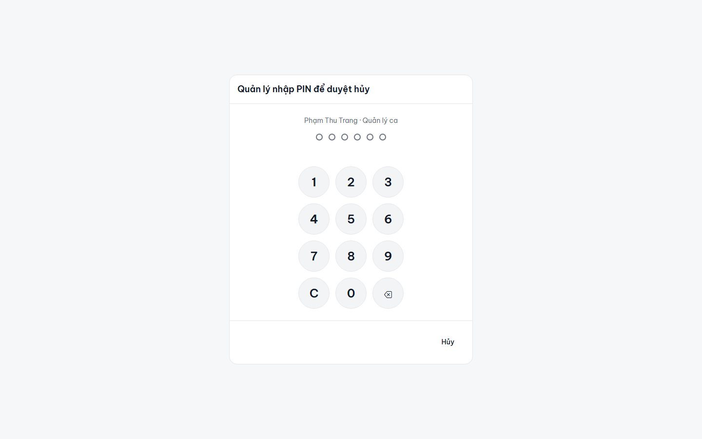

### Bước 4.3 – Cách 2: duyệt từ xa

**Thao tác:** Với một hóa đơn khác, bấm **Gửi quản lý duyệt từ xa**. Cửa sổ F (quản lý ca, đang mở `/ops`) hiện ngay popup và chuông có số 1. Bấm **Duyệt**. POS nhận kết quả ngay.

**Lời nói:** Yêu cầu có hạn 10 phút. Quản lý ở bất kỳ đâu trong rạp cũng nhận được qua SignalR, bấm Duyệt là tiền được hoàn và ghế mở bán lại.


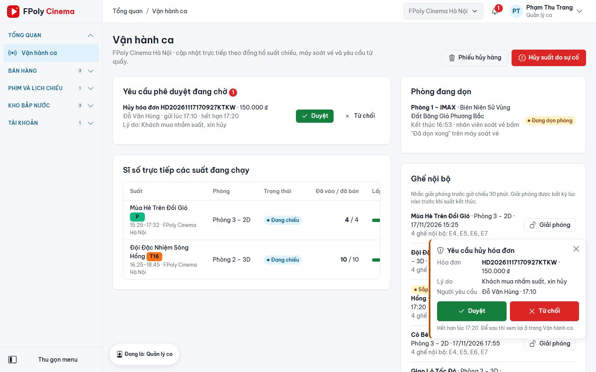

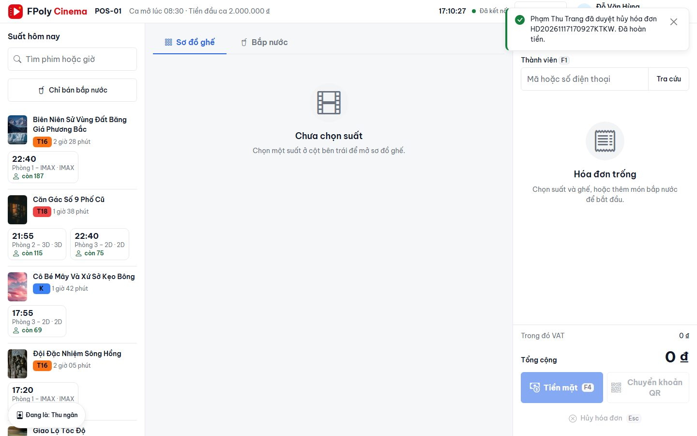

---

## Phần 5 – Soát vé (khoảng 2 phút, cửa sổ G)

Dùng mã hóa đơn của **vé bán ở bước 3.4** (suất bắt đầu trong khoảng 10 phút tới).

### Bước 5.1 – Máy soát vé và phòng đang dọn

**Thao tác:** Mở máy soát vé, chỉ vào khối "Phòng đang dọn". Quét mã vé (gõ mã HD… hoặc TK… rồi bấm **Kiểm tra**). Nếu phòng chưa dọn xong, thẻ đỏ báo "Phòng đang dọn vệ sinh, chưa thể đón khách".

**Lời nói:** Mỗi phòng có 15 phút dọn sau suất trước. Nhân viên soát vé bấm "Đã dọn xong" thì suất kế tiếp mới được mời khách vào. Cửa mở trước giờ chiếu 10 phút; quét sớm hơn thì báo "Chưa tới giờ vào, mở cửa lúc …".

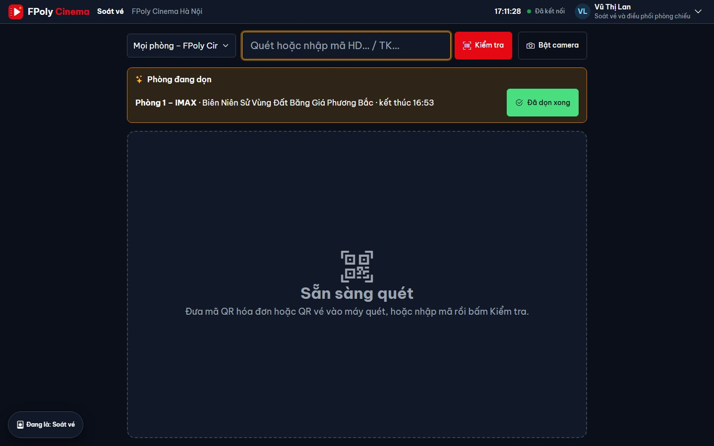

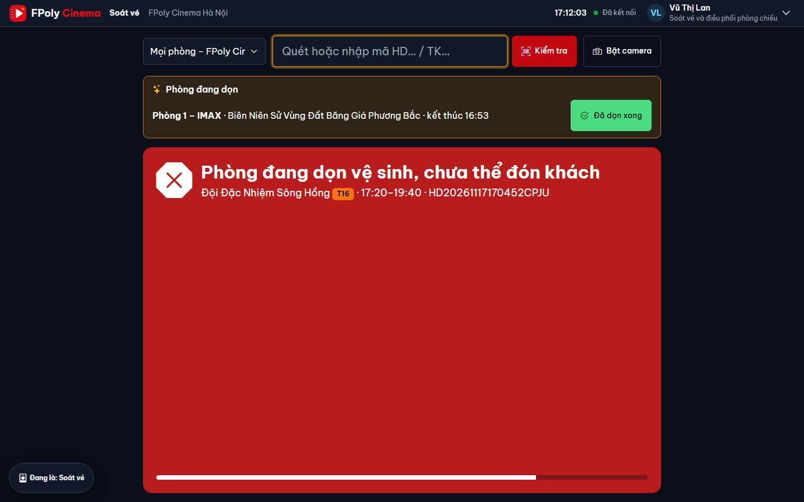

### Bước 5.2 – Kiểm tra tuổi rồi cho vào

**Thao tác:** Bấm **Đã dọn xong**, quét lại. Thẻ cam "Cần xác nhận" yêu cầu kiểm tra CCCD vì phim T16. Tích "Tôi đã kiểm tra giấy tờ…", bấm **Cho vào tất cả** → thẻ xanh "Đã cho vào".

**Lời nói:** Quét mã hóa đơn thì cho vào cả nhóm, hoặc bỏ tích từng ghế để cho vào từng người. Sĩ số phòng cập nhật trực tiếp lên trang Vận hành ca.

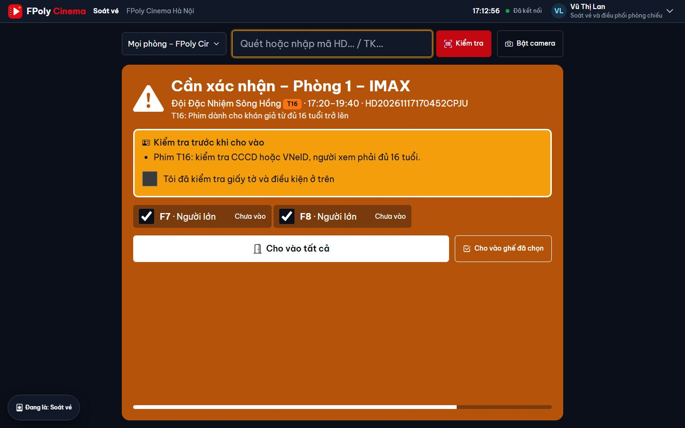

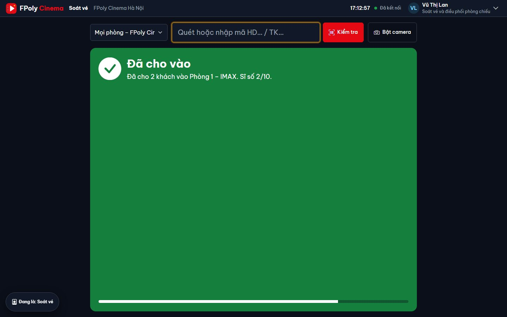

### Bước 5.3 – Chặn quét lại

**Thao tác:** Quét lại đúng mã đó → thẻ đỏ "Mọi vé của hóa đơn đã vào cửa".

**Lời nói:** Mỗi vé chỉ vào cửa một lần, nên chụp ảnh QR đưa người khác dùng lại cũng không được. Thẻ tự về trạng thái chờ sau 6 giây để quét khách tiếp theo.

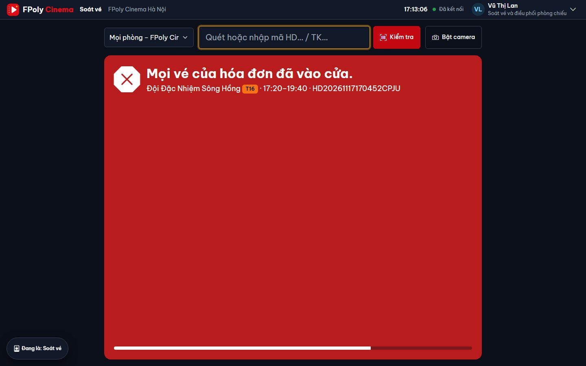

---

## Phần 6 – Quản lý (khoảng 4 phút, cửa sổ F)

### Bước 6.1 – Vận hành ca (quản lý ca)

**Thao tác:** Mở `/ops`. Chỉ lần lượt các khối: yêu cầu phê duyệt đang chờ, sĩ số trực tiếp các suất đang chạy, phòng đang dọn, ghế nội bộ.

**Lời nói:** Đây là màn hình điều hành của quản lý ca, cập nhật trực tiếp. Mỗi phòng giữ 4 ghế nội bộ cho khách đặc biệt; hệ thống nhắc giải phóng trước giờ chiếu 30 phút để bán nốt.

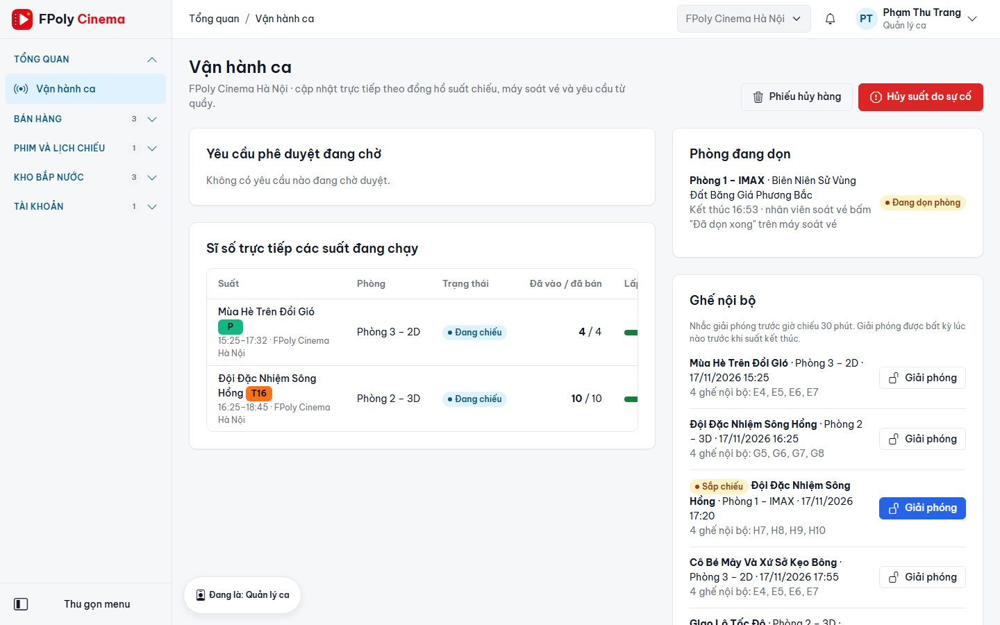

### Bước 6.2 – Hủy suất do sự cố

**Thao tác:** Bấm **Hủy suất do sự cố**, chọn một suất, nhập lý do. Chỉ vào ô "Gõ lại mã suất để xác nhận". **Không bấm hủy thật** khi demo, trừ khi đã chuẩn bị suất riêng.

**Lời nói:** Khi máy chiếu hỏng hay mất điện, quản lý hủy cả suất. Mọi hóa đơn được hoàn theo phương thức gốc, khách có tài khoản nhận voucher bồi thường 50.000 ₫ và thông báo, bắp nước chưa làm được trả lại kho. Thao tác này không hoàn tác được, nên phải gõ lại mã suất để tránh bấm nhầm.

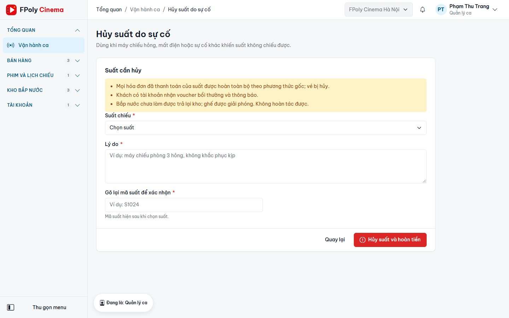

### Bước 6.3 – Bảng điều khiển (quản lý rạp)

**Thao tác:** Đổi vai trò sang **Quản lý rạp**, mở `/admin`.

**Lời nói:** Quản lý rạp xem toàn chuỗi: doanh thu hôm nay, số vé, tỷ lệ lấp đầy, doanh thu bắp nước, tỷ lệ phim Việt, biểu đồ 30 ngày và top phim. Các số này tính đúng từ hóa đơn đã thanh toán; vé em vừa bán ở phần 1 và 3 đã nằm trong đó.

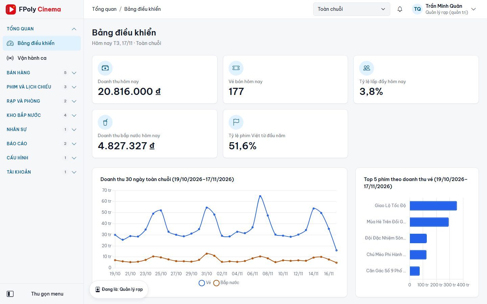

### Bước 6.4 – Quản lý phim

**Thao tác:** Mở **Phim** trong sidebar, lướt danh sách.

**Lời nói:** Mỗi phim có số giấy phép phân loại, nhãn tuổi, cảnh báo nội dung, các bản ngôn ngữ, khóa KDM và quy tắc chia doanh thu theo tuần với nhà phát hành.

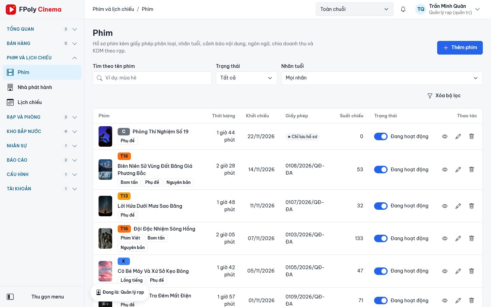

### Bước 6.5 – AI tự động xếp lịch

**Thao tác:** Mở **Lịch chiếu**, chọn một ngày còn trống (khoảng 1 tuần sau), chế độ **Gantt**. Bấm **AI tự động xếp lịch** → **Xếp lịch**. Chỉ vào thanh "Bản nháp AI", rồi bấm **Áp dụng**.

**Lời nói:** AI tính điểm nhu cầu từng phim, chia số suất theo điểm, chèn thời gian quảng cáo và dọn phòng, và ưu tiên phim Việt trong khung 18:00–22:00 để đạt tỷ lệ phim Việt tối thiểu 20% theo luật. Kết quả chỉ là bản nháp; quản lý kéo thả để chỉnh, suất bị chồng giờ có viền đỏ. Chỉ khi bấm Áp dụng mới lưu.

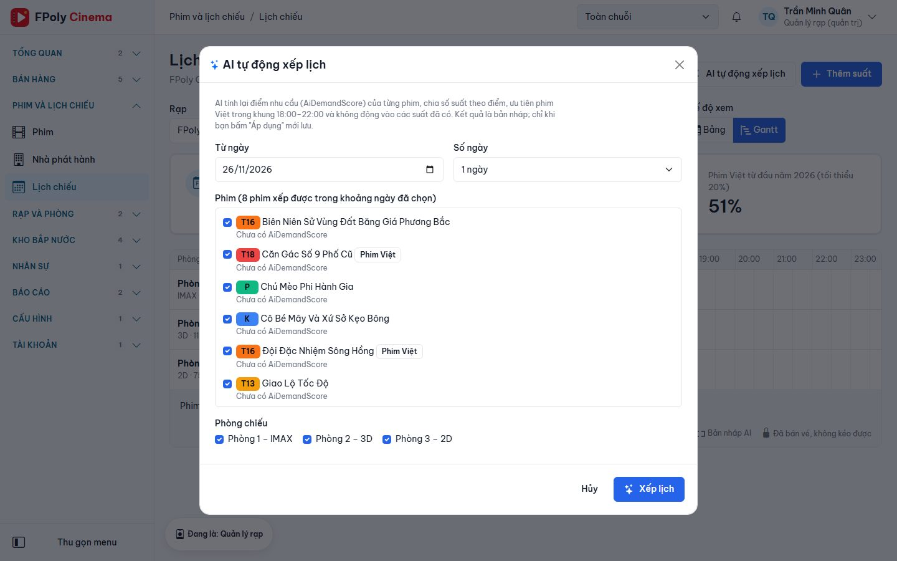

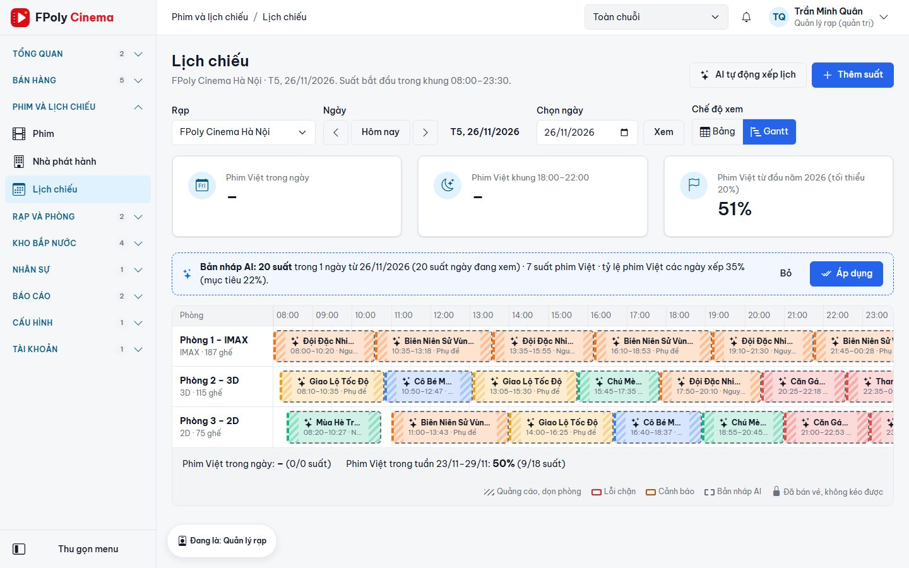

### Bước 6.6 – Bảng giá và thử tính giá

**Thao tác:** Mở **Bảng giá → Thử tính giá**, chọn thứ Bảy 20:00, IMAX, ghế VIP, đối tượng U22, phim bom tấn.

**Lời nói:** Giá vé tính theo 6 chiều: loại ngày (thường, cuối tuần, lễ, Thứ Ba vui vẻ), khung giờ, loại ghế, định dạng phòng, phim bom tấn, rồi trừ phần trăm ưu đãi theo đối tượng và làm tròn 1.000 ₫. Trang này giải thích từng dòng cộng trừ để quản lý kiểm tra trước khi áp dụng.

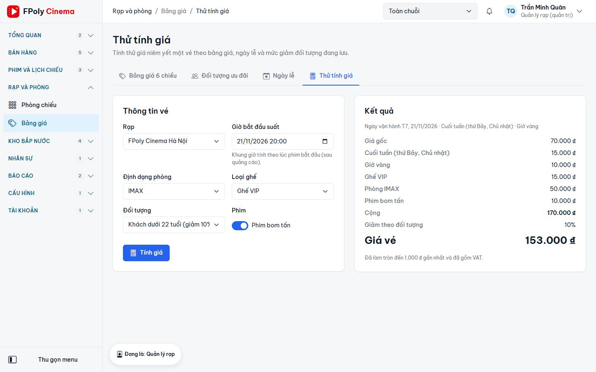

### Bước 6.7 – Thống kê và đối soát nhà phát hành

**Thao tác:** Mở **Báo cáo → Thống kê**, chỉ các tab và nút **Xuất CSV**. Sang **Đối soát nhà phát hành**, chọn *Đội Đặc Nhiệm Sông Hồng*, tuần 1, bấm **Đối soát**.

**Lời nói:** Báo cáo có doanh thu, tỷ lệ phim Việt, lấp đầy, biên bản ca và hủy hàng, đều xuất được CSV. Đối soát tính tiền trả nhà phát hành theo tỷ lệ của từng tuần, trên giá vé đã trừ VAT, có giá sàn: vé bán dưới giá sàn thì rạp tự chịu phần chênh.

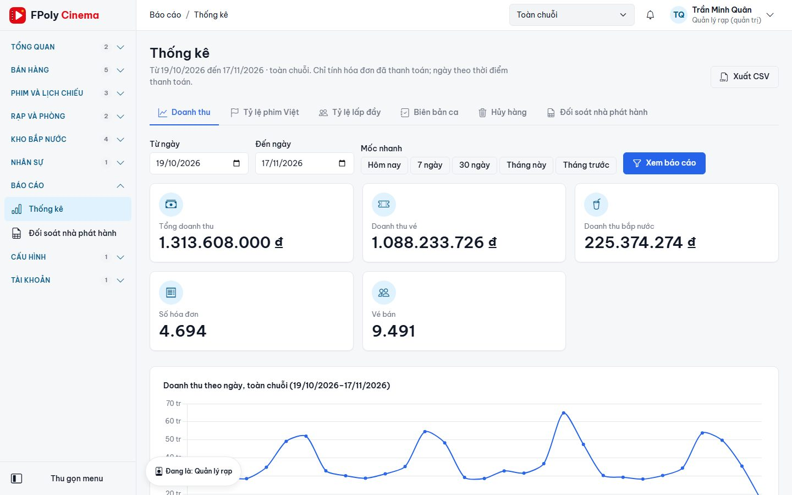

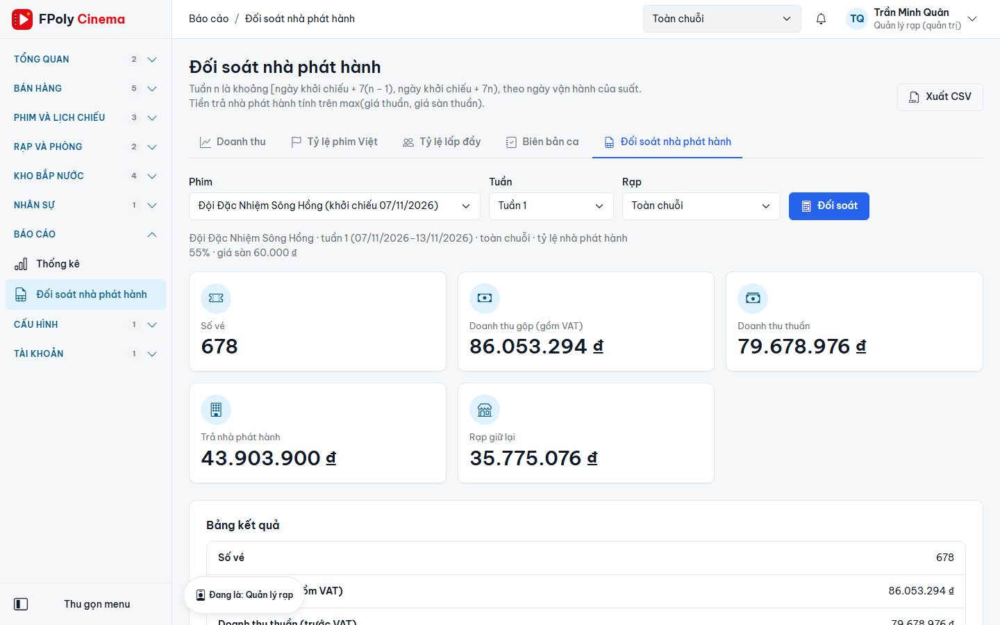

### Bước 6.8 – Cấu hình rạp (nếu còn thời gian)

**Lời nói:** Mọi tham số nghiệp vụ (giữ ghế 10 phút, dọn phòng 15 phút, hủy vé trước 2 tiếng, tỷ lệ tích điểm…) không viết cứng trong code mà đọc từ `appsettings.json` hoặc biến môi trường. Trang này chỉ để xem; ô nào khác mặc định thì có nhãn "Đã đổi".

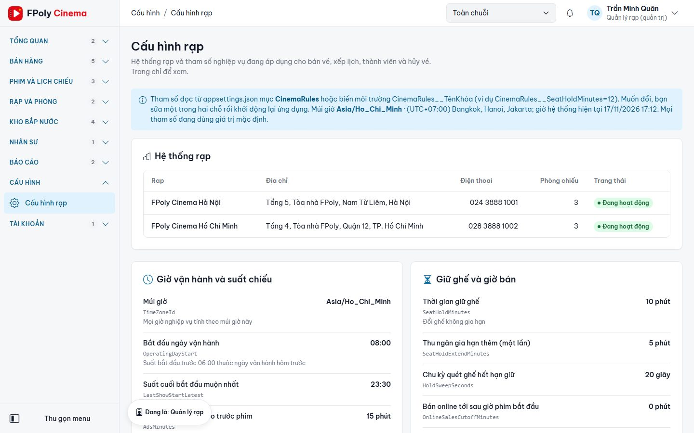

---

## Kết thúc (khoảng 30 giây)

**Lời nói:** Như vậy em đã đi hết vòng đời một tấm vé: khách đặt online có AI gợi ý ghế và trợ lý đặt vé, bếp nhận đơn khi khách tới rạp, quầy bán vé có màn hình phụ, hủy hóa đơn cần quản lý duyệt, soát vé kiểm tra phòng, tuổi và chống quét lại, và quản lý có lịch chiếu AI, bảng giá, báo cáo, đối soát. Mọi quy tắc đều kiểm tra ở server, có hơn 450 test tự động. Em cảm ơn thầy cô đã theo dõi.

---

## Phương án dự phòng khi demo

| Sự cố | Cách xử lý nhanh |
|---|---|
| Không còn suất phù hợp (quá muộn hoặc quá sớm) | Tắt app, chạy lại lệnh ở mục 0.1 với độ lệch giờ mới |
| Soát vé báo "Chưa tới giờ vào" | Chọn suất bắt đầu trong 10 phút tới, hoặc trên Trung tâm demo bấm "Tạo vé mẫu có bắp nước" |
| Nút "Tôi đã tới rạp" bị khóa | Vé phải thuộc suất bắt đầu trong vòng 60 phút; dùng vé mẫu của Trung tâm demo |
| Chấm kết nối màu vàng hoặc đỏ | Đợi 2–3 giây (đang kết nối lại) hoặc tải lại trang |
| POS báo "Chưa mở ca" | Mở `/pos/open-shift`, chọn POS-01, nhập tiền đầu ca (ví dụ 2.000.000) |
| Chrome chặn cửa sổ bật lên ở Trung tâm demo | Bấm biểu tượng chặn ở cuối thanh địa chỉ, chọn luôn cho phép, bấm lại "Mở các màn hình" |
| Toast "Phiên làm việc đã hết hạn" | Đổi vai trò lại bằng thanh "Đang là: …" (thường do vừa tạo lại DB) |

## Câu hỏi có thể gặp và gợi ý trả lời

- **Hai người bấm cùng một ghế đúng cùng lúc thì sao?** Giữ ghế chạy trong transaction có khóa theo suất chiếu (UPDLOCK, HOLDLOCK); người sau nhận `SEAT_TAKEN`, sơ đồ ghế của cả hai cập nhật qua SignalR.
- **Khách giữ ghế rồi bỏ đi thì sao?** Hóa đơn *waiting* có hạn 10 phút (gia hạn được 5 phút một lần). Dịch vụ nền quét 20 giây một lần, hết hạn thì hủy hóa đơn và trả ghế.
- **Thanh toán online xác nhận thế nào?** Cổng thanh toán gọi webhook có chữ ký; server kiểm chữ ký rồi mới chuyển hóa đơn sang *finish*. Trình duyệt chỉ hiện kết quả, không tự quyết định.
- **Vì sao thu ngân không tự hủy được hóa đơn?** Chống gian lận: hủy cần quản lý duyệt bằng PIN hoặc từ xa, ghi lại người yêu cầu, người duyệt và lý do.
- **AI gợi ý ghế dựa vào đâu?** Mỗi ghế có điểm góc nhìn và âm thanh theo vị trí trong phòng; AI tìm cụm ghế liền nhau có điểm trung bình cao nhất, không để lại ghế lẻ.
- **AI xếp lịch có ghi đè suất đã bán vé không?** Không. Nó chỉ thêm suất vào chỗ trống, kết quả là bản nháp, suất đã bán vé có biểu tượng khóa và không kéo được.
- **Dữ liệu demo lấy ở đâu?** DbSeeder sinh dữ liệu 30 ngày trước đến 7 ngày sau theo giờ lúc tạo DB: hóa đơn, vé, ca, kho, khách hàng thân thiết, nên báo cáo có số liệu thật để xem.
